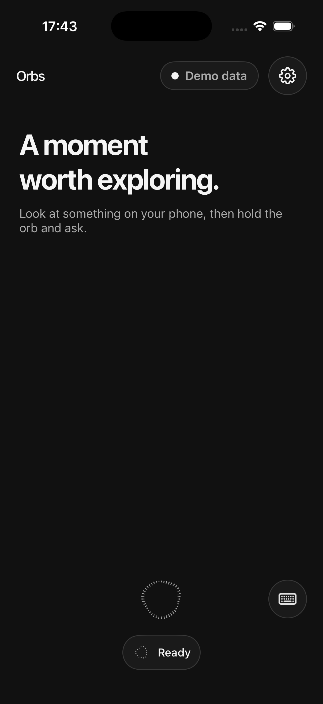
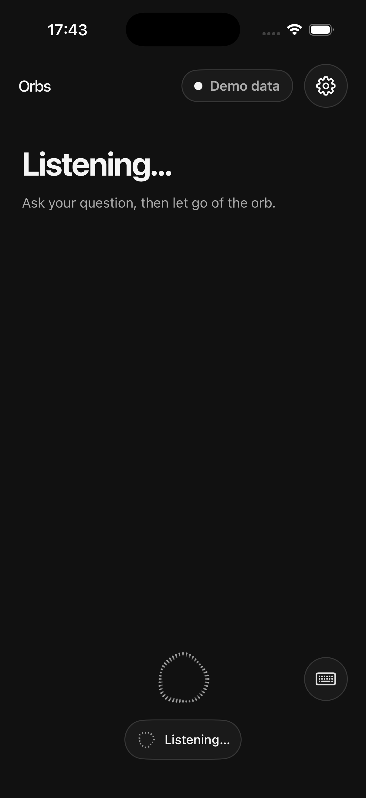
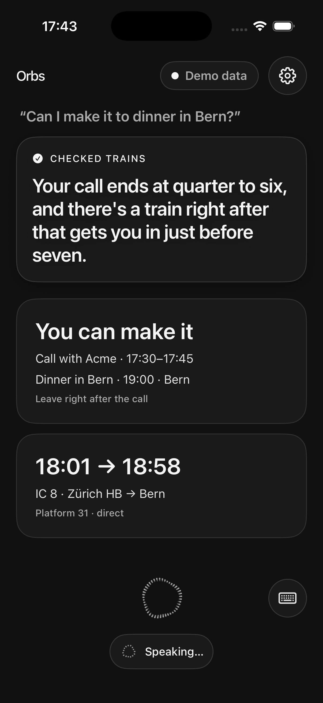
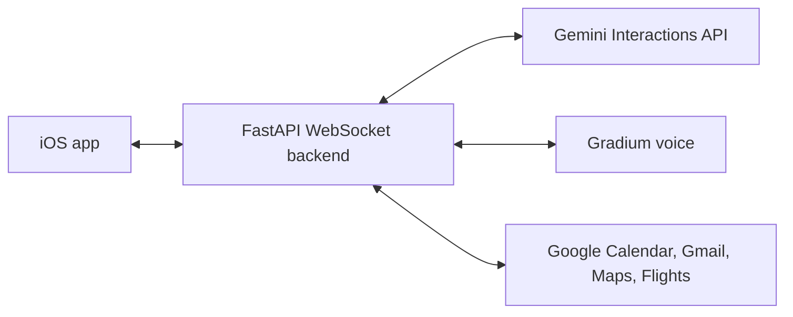

# Orbs

An iPhone voice assistant for older people: show a screen, say one sentence, and get a spoken answer plus a few cards.

The name is still open. The phone shows **Orbs**. The Xcode project, target and bundle id stay `BeaverAgent`.

## Demo video

[Watch the 2-minute demo](https://drive.google.com/file/d/1EM2Svg7D4_B8zYPoqNN1FHxesE6iV3xr/view). The same file is in the repo: [docs/demo/orb-agent-demo.mp4](docs/demo/orb-agent-demo.mp4).

## The problem

Phones assume you can read a dense screen, find the right app, and tap through it. That is a poor fit at arm's length, and a poor fit when the thing you care about is already on screen: a message, a calendar, a ticket. Orbs takes that screen and one spoken sentence, and answers out loud.

## How it works

1. The person shows a screen and says one sentence. A screenshot arrives from the Action Button Shortcut (`POST /screenshot`) or with the question. Hold the orb to talk, or turn on hands-free. A keyboard sheet can type the sentence instead.
2. The FastAPI backend sends the words and the screen reading to a Gemini agent on the Interactions API (`gemini-3.8-flash`).
3. The agent answers with one spoken line (Gradium) and up to three cards: what is on the calendar, whether a plan fits, a train, a flight, or a link.
4. Nothing is written for them. Calendar, Gmail, Tasks and Drive are read-only. A change is only a suggestion in the reply, and it waits for a confirmation.
5. Someone in the family puts the server URL and the app token in Settings. The person using the phone does not handle keys. Large text is there for reading at arm's length.

The app starts in **Demo data** and replays bundled answers with no server. Turn that off to talk to a live backend.

<p>
  
  
  
</p>

## Architecture



The phone captures the mic, a screenshot and playback. The backend runs speech-to-text, vision, the agent and text-to-speech. Train times come from the SBB open-data timetable, not from Maps. The wire format is [docs/contracts.md](docs/contracts.md). The earlier design note is [docs/voice-agent-architecture.md](docs/voice-agent-architecture.md).

## Features

- Push-to-talk and hands-free. Talking over the reply interrupts it.
- Screenshot context, read while the person is still talking. A new screenshot can start a turn on its own.
- One spoken line and cards: conflict, event, train, flight, link.
- Read-only Google Calendar, Gmail, Tasks and Drive. Places and routes when a Maps key is set. Flights search when a SerpApi key is set; otherwise a prefilled Google Flights link.
- Live SBB connections (no key).
- Demo data with no server. Light, dark, and large text.
- Typed questions, for a room where speaking is awkward.

## Tech stack

| Part | What |
| --- | --- |
| iOS | SwiftUI, iOS 17+, [a2ui-swift](https://github.com/BBC6BAE9/a2ui-swift) |
| Backend | Python 3.11+, FastAPI, WebSocket, [uv](https://docs.astral.sh/uv/) |
| Agent | Gemini 3.8 Flash on the Interactions API (`google-genai`) |
| Voice | Gradium speech-to-text and text-to-speech |
| Tools | Google Calendar, Gmail, Tasks, Drive, Places, Routes; SerpApi Google Flights; SBB `transport.opendata.ch` |

## Setup

Checked on 10 October 2026: `uv sync`, `uv run pytest -q` (138 passed), and `fake_app.py --text` against a server started from `backend/.env.example`. More detail is in [backend/README.md](backend/README.md) and [frontend/README.md](frontend/README.md). An index of the other docs is [docs/README.md](docs/README.md).

### Backend

[uv](https://docs.astral.sh/uv/) and Python 3.11+.

```bash
cd backend
uv sync
cp .env.example .env
uv run pytest -q
uv run uvicorn app:app --port 8000
```

With that server running, and `MOCK_AGENT=1` as in the example file:

```bash
uv run python fake_app.py --text "Can I make it?"
```

That prints the fixture reply and cards. It does not need a Gemini key. Spoken audio needs a valid `GRADIUM_API_KEY`. Without one, the text and cards still come back and text-to-speech logs a failure.

### Environment

Copy [backend/.env.example](backend/.env.example) to `backend/.env` (or a repo-root `.env`). Do not commit it. Values below are roles, not secrets.

| Variable | Role |
| --- | --- |
| `APP_TOKEN` | Shared secret. The app sends it on the WebSocket, and the Shortcut sends it as `Authorization: Bearer`. Any long random string. The example file ships a placeholder. |
| `GEMINI_API_KEY` | Gemini key for the agent and for reading screenshots. |
| `GEMINI_MODEL` | Model id. The example sets `gemini-3.8-flash`. |
| `GRADIUM_API_KEY` | Gradium key for speech-to-text and text-to-speech. |
| `GRADIUM_VOICE_ID` | Optional default voice. A reply can override it. |
| `GOOGLE_CLIENT_ID` | OAuth web client id for Calendar, Gmail, Tasks and Drive. |
| `GOOGLE_CLIENT_SECRET` | OAuth client secret for that web client. |
| `GOOGLE_REFRESH_TOKEN` | Refresh token for the account the agent reads. Scopes: `calendar.readonly`, `gmail.readonly`, `tasks.readonly`, `drive.readonly`. |
| `WORKSPACE_MODE` | `fixture` uses the bundled demo calendar and flight email. `rest` uses the Google token above and turns on the live tools. |
| `MOCK_AGENT` | `1` returns the fixed demo reply. Anything else uses `agent.py`. |
| `PROACTIVE_SCREEN` | `1` (default): a new screenshot can start a turn. `0`: only when asked. |
| `GOOGLE_MAPS_API_KEY` | Optional. Enable Places API (New) and Routes API, and restrict the key to those two. Without it there are no Maps tools. |
| `SERPAPI_API_KEY` | Optional. Live Google Flights results. Without it, flight search only returns a prefilled Google Flights link. |

### Reach the phone

The phone cannot use `localhost`. From [docs/work-packages.md](docs/work-packages.md):

```bash
cloudflared tunnel --url http://localhost:8000
```

Leave that running. In the app, open Settings, turn off **Use demo data**, and paste the `https://….trycloudflare.com` URL and the same `APP_TOKEN`. The app accepts `https`, `wss`, or a host with no scheme, and it connects to `/ws`.

### iOS

Xcode, iOS 17 or later. Open `frontend/BeaverAgent/BeaverAgent.xcodeproj` and run the `BeaverAgent` scheme. Under Signing & Capabilities, select your Personal Team. The command-line build, launch arguments and settings are in [frontend/README.md](frontend/README.md).

Demo data needs no signing beyond a simulator or a device you can already run, and no backend.

## Team

Built at the {Tech: Europe} Agentic AI Hack Zurich on 10 October 2026, sponsored by Google DeepMind.

- [BatuCani](https://github.com/BatuCani)
- [igorktech](https://github.com/igorktech)
- [coral2742](https://github.com/coral2742)
- [fijithecreator](https://github.com/fijithecreator)
