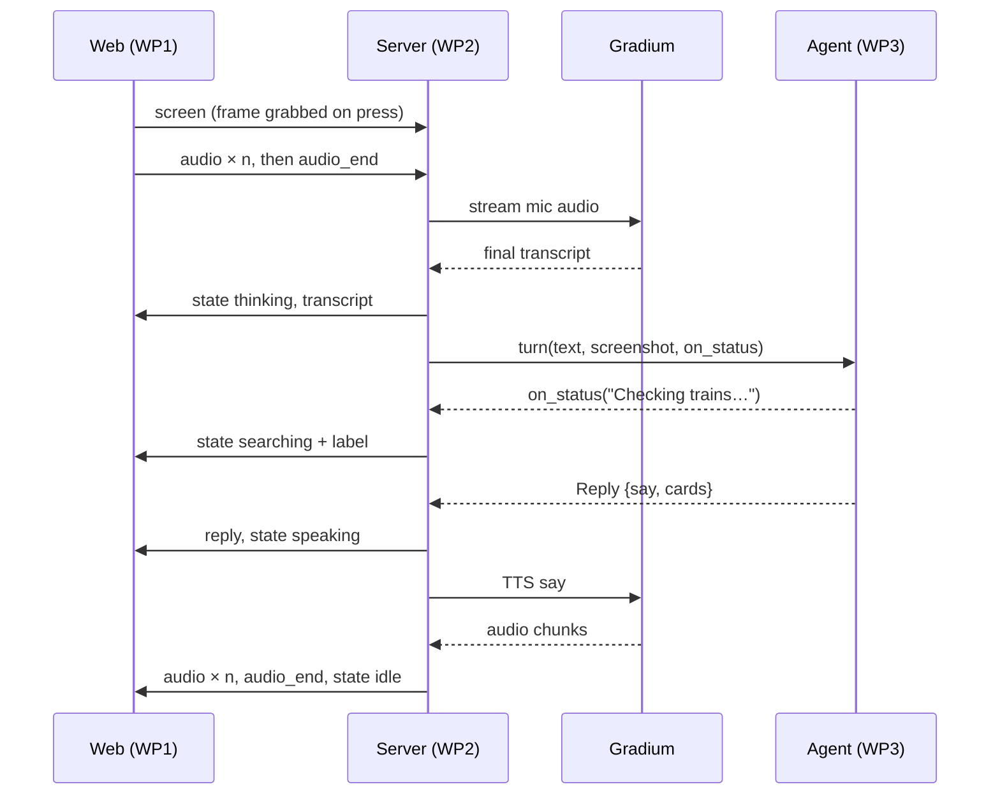

# Contracts (MVP)

The interfaces between the three [work packages](work-packages.md). If something here doesn't fit, raise it with the team before coding around it.

## Stack

| Part | Choice |
| --- | --- |
| Server | Python 3.11, uv, FastAPI and uvicorn, httpx, `google-genai`, `gradium`, python-dotenv, pytest |
| Web | Vite, React, TypeScript, plain CSS, `thinking-orbs` |
| Hosting | Server on the demo Mac, serving the web build at `/`; a Cloudflare quick tunnel when a phone needs it |
| Time zone | `Europe/Zurich` everywhere; all times on the wire are ISO 8601 with offset |

```text
server/                 # run everything from here: uv run uvicorn app:app --reload --port 8000
  pyproject.toml        # WP2 owns it; lists WP3's deps too
  .env.example
  app.py  voice.py      # WP2
  agent.py  context.py  # WP3
  tools/sbb.py          # WP3
  fixtures/             # demo_reply.json, cards.json (WP2); context.json, screen.png (WP3)
  tests/
web/                    # WP1; npm run dev proxies /ws and /screenshot to :8000
```

## One turn



## WebSocket `/ws`

JSON text frames only, one object per frame, discriminated by `type`. Audio is base64 inside JSON. The client sends `hello` first; the server closes the socket on a wrong token.

**Web → server**

| `type` | Fields | When |
| --- | --- | --- |
| `hello` | `token` | First frame after connecting |
| `audio` | `data`: base64 PCM, see [Audio](#audio) | Every ~80 ms while the orb is held |
| `audio_end` | — | Orb released; the server finalizes STT and runs the turn |
| `text` | `text` | Typed question (debug box); runs a turn without STT |
| `screen` | `mime` (`image/jpeg`), `data`: base64 | On each press, if screen sharing is on |

**Server → web**

| `type` | Fields | When |
| --- | --- | --- |
| `ready` | — | After a valid `hello` |
| `state` | `state`: `idle` \| `listening` \| `thinking` \| `searching` \| `speaking`; `label`?: string | On every change; `label` is the tool status, e.g. "Checking trains…" |
| `transcript` | `text` | Final transcript of the user's turn |
| `reply` | `say`, `cards`: see [Cards](#cards) | Before any of the turn's audio |
| `audio` | `data`: base64 PCM | TTS chunks for the last `reply` |
| `audio_end` | — | TTS for the last `reply` is complete |
| `screen_ok` | — | A screenshot arrived (WebSocket or HTTP) |
| `error` | `message` | Turn failed; the server then sends `state: idle` |

The orb shows `speaking` while the client still has audio queued, even after the server has sent `state: idle`.

## HTTP

| Route | Contract |
| --- | --- |
| `POST /screenshot` | `Authorization: Bearer <APP_TOKEN>`, body is the raw image (`image/jpeg` or `image/png`, max 8 MB). `204`. Same effect as a `screen` frame |
| `GET /health` | `{"ok": true, "workspace": "rest" \| "fixture"}` |
| `GET /` | The built web app (`web/dist`) |

The web app reads the token once from the URL fragment (`/#token=…`) and keeps it in `localStorage`.

**Screenshot rule:** the server keeps only the latest image. A turn gets it if it is less than 120 s old and no earlier turn has used it.

## Audio

Both directions use Gradium's native format, so the server forwards the base64 strings without decoding them.

| Direction | Format | Gradium side |
| --- | --- | --- |
| Mic, web → server | PCM signed 16-bit little-endian, mono, 24 kHz; 80 ms chunks = 1920 samples = 3840 bytes | STT setup `input_format: "pcm"` |
| TTS, server → web | Same format, chunks as Gradium sends them | TTS setup `output_format: "pcm_24000"` (the default `pcm` is 48 kHz) |

The web uses one `new AudioContext({sampleRate: 24000})` for capture and playback and lets the browser resample, so there's no resampling code.

**Gradium facts the server relies on** ([docs](https://docs.gradium.ai/api-reference/introduction)): auth header `x-api-key`; STT at `wss://api.gradium.ai/api/speech/asr`, TTS at `wss://api.gradium.ai/api/speech/tts`; the Python SDK is `pip install gradium`. STT needs `json_config.language` (`en` for the demo, `any` to auto-detect). STT sends `text` segments, not partial and final flags. On push-to-talk release the server sends `flush`, waits for `flushed`, and joins the segments into the transcript. TTS has no cancel message: closing the socket stops it. The free plan allows 2 TTS and 3 STT sessions at once, which is tight with 3 devs testing; the $13 XS plan raises that to 5 and 20.

## Cards

`reply.cards` holds 0 to 3 cards. The model fills them from tool results and context, and the server passes them through after validation. Optional fields may be missing; the web must render without them.

| `kind` | Fields |
| --- | --- |
| `train` | `line` ("IC 8"), `from`, `to`, `departure`, `arrival`, `platform`?, `transfers`, `delay_min`? |
| `conflict` | `event` {`title`, `start`, `end`}, `proposal` {`title`, `start`, `place`?}, `verdict`: `fits` \| `tight` \| `clash`, `note`? |
| `event` | `title`, `start`, `end`, `location`?, `source`: `calendar` \| `luma` |
| `flight` | `flight_number`, `from`, `to` (IATA or city), `departure`, `arrival`, `booking_ref`? |

`fixtures/demo_reply.json`, the expected answer to the demo question:

```json
{
  "say": "Your call ends at quarter to six, and there's a train right after that gets you in just before seven.",
  "cards": [
    {
      "kind": "conflict",
      "event": {"title": "Call with Acme", "start": "2026-10-15T17:30:00+02:00", "end": "2026-10-15T17:45:00+02:00"},
      "proposal": {"title": "Dinner in Bern", "start": "2026-10-15T19:00:00+02:00", "place": "Bern"},
      "verdict": "fits",
      "note": "Leave right after the call"
    },
    {
      "kind": "train", "line": "IC 8", "from": "Zürich HB", "to": "Bern",
      "departure": "2026-10-15T18:01:00+02:00", "arrival": "2026-10-15T18:58:00+02:00",
      "platform": "31", "transfers": 0, "delay_min": 0
    }
  ]
}
```

`fixtures/cards.json` adds one card of each remaining kind, so the web can render all four:

```json
[
  {"kind": "event", "title": "Hackathon", "start": "2026-10-17T09:00:00+02:00", "end": "2026-10-18T18:00:00+02:00", "location": "Zürich", "source": "luma"},
  {"kind": "flight", "flight_number": "LX 1820", "from": "ZRH", "to": "LIS", "departure": "2026-10-20T07:10:00+02:00", "arrival": "2026-10-20T09:15:00+01:00", "booking_ref": "K7Q2ZP"}
]
```

## Agent interface

What WP2's server calls and WP3 implements in `agent.py`. WP2's `StubAgent` has the same shape and returns `demo_reply.json`.

```python
from typing import Awaitable, Callable, TypedDict

class Reply(TypedDict):
    say: str          # one or two short sentences, the user's language
    cards: list[dict] # see Cards

Screenshot = tuple[bytes, str]  # (image bytes, mime type)

class Agent:
    async def start(self) -> None:
        """Once per WebSocket session: load_context() and build the system prompt."""

    async def turn(
        self,
        text: str,
        screenshot: Screenshot | None,
        on_status: Callable[[str], Awaitable[None]],  # tool status, e.g. "Checking trains…"
    ) -> Reply:
        """One user turn. Keeps conversation history on self. Never raises for model
        or tool errors: returns a short apology with no cards instead."""
```

## Tools

**Model-facing.** The model sees two functions and must end every turn with `respond`.

| Function | Arguments | Returns |
| --- | --- | --- |
| `sbb_connections` | `from_station`, `to_station`, `depart_after` (ISO) | `{"connections": [{"line", "from", "to", "departure", "arrival", "platform", "arrival_platform", "transfers", "delay_min", "duration_min"}]}`, at most 4 |
| `respond` | `say`, `cards` (see [Cards](#cards)) | Ends the turn |

`sbb_connections` calls `GET https://transport.opendata.ch/v1/connections?from=…&to=…&date=YYYY-MM-DD&time=HH:MM&limit=4` (no key). Map `products[0]` → `line`, `from.platform` → `platform`, `to.platform` → `arrival_platform`, `from.delay` → `delay_min`.

**Gemini rules** (`google-genai`, `generate_content`, checked 2026-10-10):

- Model `gemini-3.8-flash` with thinking level `low`. `gemini-3.5-flash` was deprecated on 8 October 2026. Don't set temperature; Gemini 3.6 and later ignore it.
- Declare functions with `parameters_json_schema`. For `cards.items`, use `anyOf` with one object per kind, each with a single-value `enum` on `kind`. Don't use `const`, `oneOf` or `$defs`, keep it shallow, and validate the arguments in code anyway.
- Function calling mode `ANY` on every step, so the model always calls `sbb_connections` or `respond` and never returns free text. On the last step add `allowed_function_names=["respond"]`.
- Append `response.candidates[0].content` to the history unmodified; it carries the thought signatures, and dropping them gives a 400. Then add one function response per call, with the call's `id` and `name`, after all the calls.
- Attach the screenshot as an inline image part at medium media resolution (560 tokens); that's enough to read a chat message.

**Workspace access:** REST with a refresh token for the temporary account. The remote MCP servers (`calendarmcp.googleapis.com/mcp/v1`, `gmailmcp.googleapis.com/mcp/v1`) need Developer Preview enrollment, which takes days, and their terms forbid use in public apps before GA. Switch to them only if we're already enrolled.

**Context.** `context.load_context()` runs once per session and goes into the system prompt as JSON:

```json
{
  "events": [{"title": "Call with Acme", "start": "2026-10-15T17:30:00+02:00", "end": "2026-10-15T17:45:00+02:00", "location": "Zoom", "source": "calendar"}],
  "flight_emails": [{"subject": "Your booking K7Q2ZP: Zürich – Lisbon", "from": "SWISS", "date": "2026-10-09", "body": "first 2000 characters of the text body"}]
}
```

Events cover now to 7 days ahead. `source` is `luma` when the event's description or organizer mentions lu.ma. `WORKSPACE_MODE=fixture` returns `fixtures/context.json` with this exact shape.

## Environment

`server/.env`, never committed; `server/.env.example` lists them all.

| Variable | Used by | Notes |
| --- | --- | --- |
| `APP_TOKEN` | WP2, WP1 via URL fragment | Any long random string |
| `GEMINI_API_KEY`, `GEMINI_MODEL` | WP3 | `gemini-3.8-flash` |
| `GRADIUM_API_KEY`, `GRADIUM_VOICE_ID` | WP2 | Voice: the cloned mascot or a stock voice |
| `GOOGLE_CLIENT_ID`, `GOOGLE_CLIENT_SECRET`, `GOOGLE_REFRESH_TOKEN` | WP3 | Temporary account only, read-only scopes |
| `WORKSPACE_MODE` | WP3 | `rest` or `fixture` |
| `MOCK_AGENT` | WP2 | `1` uses `StubAgent` |

## Later, not in the MVP

Each of these fits without breaking the contract above:

- **A2UI** (v0.9.1 is current, checked 2026-10-10): each card becomes one surface. The server sends `{"version": "v0.9", "createSurface": {"surfaceId": "t3-0", "catalogId": "<our catalog URI>"}}`, then `updateComponents` with a single component `{"id": "root", "component": "TrainCard", ...card fields}`. The web uses `@a2ui/react` and `@a2ui/web_core` (0.13.0, zod 3 peer) with `MessageProcessor`, `A2uiSurface` and a custom `Catalog`. Known traps: import from the `/v0_9` subpaths, process messages one at a time (a bad message aborts the batch), and trust the JSON schemas over the prose docs, which contradict them in places. That's why it isn't in a 3-hour MVP.
- **Word-timed highlights:** a `cue` message carrying `card_index` and `at_ms`, from Gradium word timestamps.
- **Filler line:** an extra short `reply` with no cards, spoken while a tool runs.
- **Barge-in:** an `interrupt` message from the web; the server cancels the turn and the TTS stream.
