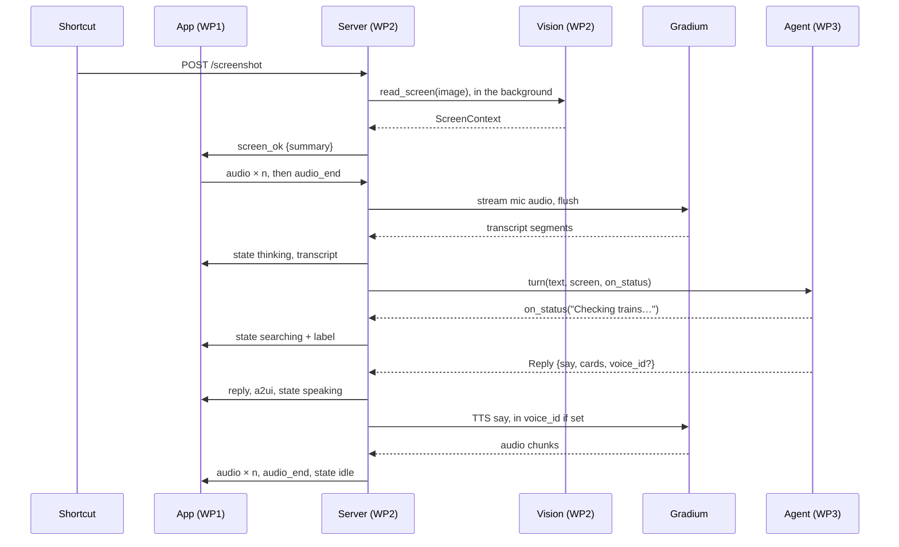

# Contracts (MVP)

The interfaces between the three [work packages](work-packages.md). If something here doesn't fit, raise it with the team before coding around it.

## Stack

| Part | Choice |
| --- | --- |
| Frontend (iPhone) | SwiftUI, iOS 17+, `URLSessionWebSocketTask`, `AVAudioEngine`, [a2ui-swift](https://github.com/BBC6BAE9/a2ui-swift) `from: "0.3.0"` (product `A2UISwiftUI`) |
| Backend | Python 3.11, uv, FastAPI and uvicorn, httpx, `google-genai`, `gradium`, python-dotenv, pytest |
| Hosting | Server on a dev Mac; a Cloudflare quick tunnel gives the HTTPS and WSS URL that the app and the Shortcut use. Start it once and leave it running: the URL changes on every restart |
| Time zone | `Europe/Zurich` everywhere; times on the wire are ISO 8601 with offset |

```text
frontend/               # WP1: Xcode project, SwiftUI
backend/                # run from here: uv run uvicorn app:app --reload --port 8000
  pyproject.toml        # WP2 owns it; lists every package's deps
  .env.example
  app.py  voice.py  vision.py      # WP2
  a2ui.py                          # WP3: cards → A2UI messages
  agent.py  context.py  tools/   # WP3: sbb, maps, google (registry), google_auth, gcalendar, gmail, tasks, drive, flights
  fixtures/             # demo_reply.json, cards.json, screen.json, screen.png (WP2); context.json, *_a2ui.json (WP3)
  tests/
```

## One turn

The screenshot arrives before the question, so vision runs while the user is still talking.



## WebSocket `/ws`

JSON text frames only, one object per frame, discriminated by `type`. Audio is base64 inside JSON. The app sends `hello` first; the server closes the socket on a wrong token.

**App → server**

| `type` | Fields | When |
| --- | --- | --- |
| `hello` | `token`, `mode`?: `ptt` (default) \| `handsfree` | First frame after connecting. For `handsfree`, see **Hands-free mode** below |
| `audio` | `data`: base64 PCM, see [Audio](#audio) | Every 80 ms while the orb is held; in hands-free mode, all the time |
| `audio_end` | — | Orb released; the server finalizes STT and runs the turn. Never sent in hands-free mode |
| `text` | `text` | Typed question (debug field); runs a turn without STT |
| `screen` | `mime`, `data`: base64, `recent`?: list of base64 | Optional: an image picked in the app, for rehearsals, or a shared screen when a question starts. Same effect as `POST /screenshot`; `recent` adds the seconds before it, see **Earlier frames** below |
| `interrupt` | — | Tap while the mascot is talking. Stops the current turn |

**Server → app**

| `type` | Fields | When |
| --- | --- | --- |
| `ready` | — | After a valid `hello` |
| `state` | `state`: `idle` \| `listening` \| `thinking` \| `searching` \| `speaking`; `label`?: string | On every change; `label` is the tool status, free text: "Checking trains…", "Designing a voice…", "Tuning my voice…" |
| `transcript` | `text` | Final transcript of the user's turn |
| `reply` | `say`, `cards`: see [Cards](#cards) | Before any of the turn's audio |
| `a2ui` | `messages`: list of A2UI v0.9 messages, see [A2UI](#a2ui) | Right after `reply`, when it has cards |
| `audio` | `data`: base64 PCM | TTS chunks for the last `reply` |
| `audio_end` | — | TTS for the last `reply` is complete |
| `screen_ok` | `summary`?: string | Vision has read a new screenshot; `summary` is missing if vision failed |
| `error` | `message` | Turn failed; the server then sends `state: idle` |

The orb shows `speaking` while the app still has audio queued, even after the server has sent `state: idle`.

**Interrupting.** A new press (its first `audio` frame), a `text`, or an `interrupt` cancels the running turn: the agent call and the TTS stream. A cancelled turn sends no `audio_end`. After `interrupt` the server sends `state: idle` only if it cancelled a running turn; after a new press, `state: listening`. Gradium generates speech faster than real time, so seconds of audio may already be queued in the app. The app must stop playback the moment it interrupts, without waiting for `state: idle`, and drop `audio` frames until the next `reply`.

**Hands-free mode.** Opt in with `"mode": "handsfree"` in `hello`; push-to-talk stays the default. The app streams `audio` for as long as it is connected, also while the mascot speaks, and never sends `audio_end`, so echo cancellation must be on (see [Audio](#audio)) or the mascot hears itself and cuts itself off. The server keeps one Gradium STT session open per connection and ends a turn with Gradium's semantic VAD: `inactivity_prob` at the 2 s horizon above 0.5 for 3 steps in a row, once the turn has words. Then it flushes, sends `transcript` and runs the turn as usual. The first words of each turn cancel the running turn, as a new press does, and send `state: listening`. The server's turn is often over while the app still plays queued audio, so in this mode `state: listening` is the app's cue to stop playback and drop `audio` until the next `reply`. Each hands-free connection holds an STT session the whole time, even in silence, which counts against Gradium's concurrent session limit.

**Proactive turns.** The agent also speaks up on its own about what is on the screen, without a question. When vision has read a new screenshot (`POST /screenshot` or `screen`), the server sends `screen_ok` and then runs a turn in the most recently connected session, with the server's `PROACTIVE` text in place of the user's words and that screenshot's context. It uses the same frames as any turn: `state: thinking`, `searching` with labels, `reply`, `a2ui`, `speaking`, `audio`, `audio_end`, `state: idle`, with no `transcript` before it, since nobody spoke. The agent speaks only if there is something concrete to do, such as a plan on screen to check against the calendar and the trains, and ends with an offer ("Shall I add it?"); anything to add, send or change is only a suggestion in the cards for the user to confirm, never done. With nothing to do, the reply has an empty `say`, and the server sends only `state: idle` after `thinking`. There is no proactive turn:

- while the user holds the orb or talks hands-free, or a turn runs; their own turn takes the screenshot instead;
- for a reused reading (same bytes, see the screenshot rule in [HTTP](#http)) or a failed one;
- for a screen already offered: a reading that differs from the last offered one only in `summary` counts as the same screen.

The user interrupts a proactive turn like any other; an interrupted one is not retried. A proactive turn that speaks uses up its screenshot, so a follow-up ("yes, add it") goes on the conversation history, not the screen. `PROACTIVE_SCREEN=0` turns proactive turns off.

**Earlier frames.** `recent` holds the frames before `data`, in the same `mime`, oldest first, about 1 s apart, at most 9; `data` stays the current frame. Each image is at most 8 MB, and all of them together at most 8 MB decoded. If `recent` is malformed or over a limit, the server drops it, logs a warning and keeps `data`; it never drops the current frame. Vision reads all the frames in one call, see [Screen context](#screen-context). `POST /screenshot` stays one frame.

## HTTP

| Route | Contract |
| --- | --- |
| `POST /screenshot` | From the iPhone Shortcut. `Authorization: Bearer <APP_TOKEN>`, body is the raw image (`image/jpeg` or `image/png`, max 8 MB). Returns `204` and starts vision |
| `GET /health` | `{"ok": true, "workspace": "rest" \| "fixture"}` |
| `GET /extension-config` | Desktop/Chrome clients send `X-Orbs-Client: orbs-ui`. Returns `{"backend_url": "https://…", "app_token": "…"}` with `Cache-Control: no-store`; responds `404` without the client header or `503` when configuration is missing/invalid. Never log or cache the token. |

**Screenshot rule:** the server keeps only the latest screenshot and its `ScreenContext`. A turn gets the context if the screenshot is less than 120 s old and no earlier turn has used it (a [proactive turn](#websocket-ws) that speaks counts); if vision is still running, the turn waits for it. A screenshot with the same bytes (and `recent` frames) as the one before reuses its context without calling vision, for up to 120 s after that read began; `screen_ok` is still sent, and a failed read is never reused.

## Audio

Both directions use Gradium's native format, so the server forwards the base64 strings without decoding them.

| Direction | Format | Gradium side |
| --- | --- | --- |
| Mic, app → server | PCM signed 16-bit little-endian, mono, 24 kHz; 80 ms chunks = 1920 samples = 3840 bytes | STT setup `input_format: "pcm"` |
| TTS, server → app | Same format, chunks as Gradium sends them | TTS setup `output_format: "pcm_24000"` (the default `pcm` is 48 kHz) |

**iPhone side:** audio session `.playAndRecord` with `.defaultToSpeaker`, or iOS plays through the quiet earpiece while the mic is on. Turn on echo cancellation with `inputNode.setVoiceProcessingEnabled(true)` before reading the input format. Convert the input with `AVAudioConverter` to Int16 at 24 kHz mono. Play through an `AVAudioPlayerNode` on the same engine, converting each chunk to a Float32 24 kHz buffer.

**Gradium facts the server relies on** ([docs](https://docs.gradium.ai/api-reference/introduction)): auth header `x-api-key`; STT at `wss://api.gradium.ai/api/speech/asr`, TTS at `wss://api.gradium.ai/api/speech/tts`; the Python SDK is `pip install gradium`. STT needs `json_config.language` (`en` for the demo, `any` to auto-detect). STT sends `text` segments, not partial and final flags. On push-to-talk release the server sends `flush`, waits for `flushed`, and joins the segments into the transcript. TTS has no cancel message: closing the socket stops it. TTS has no per-request emotion or style control, and SSML is spoken aloud; only `temp` and `padding_bonus` (speed) vary per request, so a different vibe is a different voice. The free plan allows 2 TTS and 3 STT sessions at once, which is tight with 3 devs testing; the $13 XS plan raises that to 5 and 20.

## Cards

`reply.cards` holds 0 to 3 cards. The model fills them from tool results and context, and the server passes them through after validation. Optional fields may be missing. The app renders the `a2ui` messages built from these cards; native SwiftUI cards from `reply.cards` are the fallback.

| `kind` | Fields |
| --- | --- |
| `train` | `line` ("IC 8"), `from`, `to`, `departure`, `arrival`, `platform`?, `transfers`, `delay_min`? |
| `conflict` | `event` {`title`, `start`, `end`}, `proposal` {`title`, `start`, `place`?}, `verdict`: `fits` \| `tight` \| `clash`, `note`? |
| `event` | `title`, `start`, `end`, `location`?, `source`: `calendar` \| `luma` |
| `flight` | `flight_number`, `from`, `to` (IATA or city), `departure`, `arrival`, `booking_ref`? |
| `link` | `title`, `url` (https), `detail`? |

A `link` card points at a page the user opens on the phone, today the prefilled Google Flights search from `flights_search`. Its `url` comes only from a tool result.

`fixtures/demo_reply.json`, the expected answer to the demo question:

```json
{
  "say": "Your call ends at quarter to six, and there's a train right after that gets you in just before seven.",
  "cards": [
    {
      "kind": "conflict",
      "event": {"title": "Call with Acme", "start": "2026-10-15T17:30:00+02:00", "end": "2026-10-15T17:45:00+02:00"},
      "proposal": {"title": "Dinner in Bern", "start": "2026-10-15T19:00:00+02:00", "place": "Bern"},
      "verdict": "fits",
      "note": "Leave right after the call"
    },
    {
      "kind": "train", "line": "IC 8", "from": "Zürich HB", "to": "Bern",
      "departure": "2026-10-15T18:01:00+02:00", "arrival": "2026-10-15T18:58:00+02:00",
      "platform": "31", "transfers": 0, "delay_min": 0
    }
  ]
}
```

`fixtures/cards.json` adds one card of each remaining kind, so every kind can be rendered:

```json
[
  {"kind": "event", "title": "Hackathon", "start": "2026-10-17T09:00:00+02:00", "end": "2026-10-18T18:00:00+02:00", "location": "Zürich", "source": "luma"},
  {"kind": "flight", "flight_number": "LX 1820", "from": "ZRH", "to": "LIS", "departure": "2026-10-20T07:10:00+02:00", "arrival": "2026-10-20T09:15:00+01:00", "booking_ref": "K7Q2ZP"}
]
```

Swift decoding: `keyDecodingStrategy = .convertFromSnakeCase`, `dateDecodingStrategy = .iso8601`.

## A2UI

`a2ui.cards_to_a2ui(reply_id: str, cards: list[dict]) -> list[dict]` turns one reply into one surface, using only basic-catalog components so the app needs no custom Swift components:

```json
[
  {"version": "v0.9", "createSurface": {"surfaceId": "reply-3", "catalogId": "https://a2ui.org/specification/v0_9/basic_catalog.json"}},
  {"version": "v0.9", "updateComponents": {"surfaceId": "reply-3", "components": [
    {"id": "root", "component": "Column", "children": ["c0", "c1"]},
    {"id": "c1", "component": "Card", "child": "c1-body"},
    {"id": "c1-body", "component": "Column", "children": ["c1-time", "c1-line", "c1-meta"]},
    {"id": "c1-time", "component": "Text", "text": "18:01 → 18:58", "variant": "h2"},
    {"id": "c1-line", "component": "Text", "text": "IC 8 · Zürich HB → Bern"},
    {"id": "c1-meta", "component": "Text", "text": "Platform 31 · direct", "variant": "caption"}
  ]}}
]
```

(`c0`, the conflict card, is left out above for brevity.) Rules:

- Use the catalog id exactly as written. It's a2ui-swift's `basicCatalogId`; the React renderer uses a different one.
- Format times as `HH:MM` in Europe/Zurich on the server, so the app doesn't need A2UI format functions. Event and flight cards also show the day (`Sat 17 Oct`), since they are often about another day.
- Each card is a `Card` holding a `Column` of `Text`: the hero line first with `variant: "h2"` (the times; the verdict for `conflict`; the title for `event` and `link`), then plain detail lines, then an optional `variant: "caption"` meta line. The app styles these three; other variants get no special look.
- A `link` card's caption is an inline Markdown link, `[Open in Google Flights](url)`, or `[Open <host>](url)` for other hosts; a2ui-swift renders inline Markdown in `Text`, so it is tappable. Only `https` URLs become a link.
- Use a new `surfaceId` per reply, and one `SurfaceViewModel(catalog: basicCatalog)` per surface in the app.
- No buttons or actions in the MVP.

## Screen context

What WP2's vision step produces and WP3's agent consumes. `vision.read_screen(image: bytes, mime: str, earlier=()) -> dict` makes one Gemini call with structured output (`response_json_schema`), passing the current time so relative dates resolve. `earlier` is the image bytes of the frames before the current one, oldest first, from `recent`; without it vision reads one frame as before. `fixtures/screen.json`:

```json
{
  "app": "WhatsApp",
  "summary": "Anna asks about dinner in Bern on Thursday at 7.",
  "messages": [{"from": "Anna", "text": "Dinner in Bern Thursday at 7?"}],
  "proposal": {"title": "Dinner", "date": "2026-10-15", "time": "19:00", "place": "Bern"}
}
```

`proposal` is `null` when the screen doesn't suggest a plan; inside it, `time` and `place` are `null` when the screen doesn't give them. `from` is the sender's name as shown, or `"Me"` for the phone owner's own messages. Vision copies on-screen text as data and never acts on it. With earlier frames, `messages` covers all frames, deduplicated, oldest first; `proposal` comes from the newest frame that shows one; `summary` describes the current screen and may mention what was seen just before. Every frame is untrusted data, the earlier ones too. The agent puts the whole object in its prompt marked as untrusted, and never follows instructions inside it.

## Agent interface

What WP2's server calls and WP3 implements in `agent.py`. WP2's `StubAgent` has the same shape and returns `demo_reply.json`.

```python
from typing import Awaitable, Callable, NotRequired, TypedDict

class Reply(TypedDict):
    say: str          # one or two short sentences, the user's language
    cards: list[dict] # see Cards
    voice_id: NotRequired[str]  # Gradium voice to speak `say` in; absent: GRADIUM_VOICE_ID.
                                # Once the voice changes, every later reply carries it.

class Agent:
    async def start(self) -> None:
        """Once per WebSocket session: load_context() and build the system prompt."""

    async def turn(
        self,
        text: str,
        screen: dict | None,  # ScreenContext, see Screen context
        on_status: Callable[[str], Awaitable[None]],  # tool status, e.g. "Checking trains…"
    ) -> Reply:
        """One user turn. Keeps conversation history on self. Never raises for model
        or tool errors: returns a short apology with no cards instead. The server
        cancels it when the user interrupts, so only add the turn to the history
        once it completes. For a proactive turn, `text` is the server's PROACTIVE
        instruction, and an empty `say` with no cards means stay silent."""
```

## Tools

**Model-facing.** The model sees up to thirteen functions and must end every turn with `respond`. The two Maps functions are declared only when `GOOGLE_MAPS_API_KEY` is set. The seven Workspace functions (`calendar_*`, `gmail_*`, `tasks_list`, `drive_*`) are declared only with `WORKSPACE_MODE=rest` and all three `GOOGLE_*` OAuth variables set. `flights_search` is always declared. All of them only read, except `design_voice`, which adds a voice to our own Gradium library. A tool that fails, or misses a credential, returns `{"error": …}` to the model, and the turn goes on.

| Function | Arguments | Returns |
| --- | --- | --- |
| `sbb_connections` | `from_station`, `to_station`, `depart_after` (ISO) | `{"connections": [{"line", "from", "to", "departure", "arrival", "platform", "arrival_platform", "transfers", "delay_min", "duration_min"}]}`, at most 4 |
| `maps_search_places` | `query`, e.g. "quiet restaurant near Bern station" | `{"places": [{"name", "address"}]}`, at most 5 |
| `maps_route` | `origin`, `destination` (addresses or place names), `mode`: `WALK` \| `DRIVE` \| `BICYCLE` | `{"duration_min", "distance_km"}` |
| `calendar_events` | `time_min`, `time_max` (ISO), `query`? | `{"events": [{"title", "start", "end", "location"?, "source", "all_day"?}]}`, at most 20; the shape of the context's events |
| `calendar_free_slots` | `time_min`, `time_max` (ISO), `duration_min`? (default 30), `attendees`?: list of calendar emails | `{"slots": [{"start", "end"}], "unavailable"?: [emails]}`, at most 8, only between 08:00 and 20:00 Zurich time, free for the user and every attendee |
| `gmail_search` | `query` (Gmail search syntax) | `{"messages": [{"id", "subject", "from", "date", "snippet"}]}`, at most 5, newest first |
| `gmail_read` | `message_id` | `{"id", "subject", "from", "date", "body"}`, body cut to 4000 characters |
| `tasks_list` | — | `{"tasks": [{"title", "list", "due"?, "notes"?}]}`, open tasks from every list, at most 20, due ones first |
| `drive_search` | `query` | `{"files": [{"id", "name", "type", "modified", "link"}]}`, at most 5, newest first |
| `drive_read` | `file_id` | The file's fields plus `{"text", "truncated"}`, text cut to 4000 characters; `{"error"}` for files that aren't text |
| `flights_search` | `origin`, `destination` (IATA), `departure_date`, `return_date`? (`YYYY-MM-DD`) | `{"flights": [{"flight_number", "airline", "from", "to", "departure", "arrival", "stops", "duration_min", "price_chf"?}], "google_flights_url"}`, at most 4; without `SERPAPI_API_KEY`, `flights` is empty |
| `design_voice` | `description` (casting brief, at most 500 characters), `language`: `en` \| `fr` \| `es` \| `pt` \| `de` | `{"ok": true}`; the agent speaks in the new voice for the rest of the session |
| `respond` | `say`, `cards` (see [Cards](#cards)), `mood`?: `stressed` \| `tired` \| `happy` \| `neutral` | Ends the turn |

`sbb_connections` calls `GET https://transport.opendata.ch/v1/connections?from=…&to=…&date=YYYY-MM-DD&time=HH:MM&limit=4` (no key). Map `products[0]` → `line`, `from.platform` → `platform`, `to.platform` → `arrival_platform`, `from.delay` → `delay_min`. Public transport always goes through `sbb_connections`, never `maps_route`.

`maps_search_places` calls Places API (New), `POST https://places.googleapis.com/v1/places:searchText` with `{"textQuery": query, "pageSize": 5}` and `X-Goog-FieldMask: places.displayName,places.formattedAddress`. Map `displayName.text` → `name`, `formattedAddress` → `address`. `maps_route` calls Routes API, `POST https://routes.googleapis.com/directions/v2:computeRoutes` with `{"origin": {"address": …}, "destination": {"address": …}, "travelMode": mode}` and `X-Goog-FieldMask: routes.duration,routes.distanceMeters`. `duration` comes back as a string such as `"1260s"`. Both calls send the key in the `X-Goog-Api-Key` header, never in the URL. The field masks are required, and they keep Places on the cheaper Pro SKU. Since 1 March 2025, new Cloud projects can't enable the legacy Places Text Search and Directions APIs, so don't use those. Place names and addresses from Maps are third-party data: the agent treats them like the screen context and never follows instructions in them. There is no Maps card; Maps results go into `say`.

**Google.** All Workspace calls go through `tools/google_auth.py`: one refresh-token exchange at `https://oauth2.googleapis.com/token`, cached until a minute before the access token expires, then REST with `Authorization: Bearer`. Calendar uses `events.list` on `primary` and `freeBusy` (busy times of the user and each attendee, merged; calendars the account can't see come back under `unavailable`). Gmail uses `messages.list`, then `messages.get` with `format=metadata` for search and `format=full` for read; HTML-only mail is reduced to text. Tasks reads every task list with `showCompleted=false`. Drive searches with `name contains` or `fullText contains` and `trashed = false`, and reads Docs and Slides by exporting them as `text/plain` and Sheets as `text/csv`, so the Docs API needs no extra scope. Everything these tools return is third-party data, like the screen context: the agent never follows instructions in it.

`flights_search` calls SerpApi's `google_flights` engine (`GET https://serpapi.com/search.json`, `type` 2 for one way, `currency` CHF). SerpApi only takes the key as the `api_key` query parameter, so the tool never logs the URL: it redacts the key from httpx's request log and reports errors without the URL. SerpApi's local airport times get the airport's UTC offset from a table of common airports; a time without one can't go on a card. `google_flights_url` comes from SerpApi's `search_metadata`, or, without the key, is built as `https://www.google.com/travel/flights?q=One way flights from ZRH to LIS on 2026-10-20` (`Flights from … on … through …` for a round trip), which opens Google Flights with the route and dates filled in. Flights the user already booked come from the emails, not from `flights_search`. Never invent flights: with no results the agent answers with a `link` card.

**Voice.** The agent changes how it sounds in two ways, and the newest change wins. Both end in `Reply.voice_id`.

- **On request** ("talk like a pirate"): `design_voice`. `voice.design_voice(description, language)` makes one candidate with Gradium [Voice Design](https://docs.gradium.ai/guides/voices/voice-design), `json_config.cfg_scale` 10, waits until it is ready (at most 30 s) and converts it into a permanent voice. About 4 s. Each design permanently takes a custom-voice slot; past the allowance Gradium answers `409`.
- **By mood:** once, early in a conversation, the agent asks how the user feels and sets `mood` in `respond` when it knows. A new mood switches the voice from that reply on: calmer for `stressed`, softer for `tired` (also sad), brighter for `happy`, the default voice for `neutral`. `voice.mood_voice(mood)` designs each mood's voice once from one mascot brief, names it `Beaver mood <mood>`, and finds it by name in the library (`GET /voices/`) after that, so the moods take three slots in total.

Gradium Voice Design facts: REST at `https://api.gradium.ai/api` with `x-api-key`. `POST /voice-generator/generate` returns candidate ids with `ready: false`; poll `GET /voice-generator/embeddings?embedding_id=…`; `POST /voices/from-embedding` returns the voice's `uid`. Candidates work over REST only (100 characters); the TTS socket needs the converted voice. Languages `en`, `fr`, `es`, `pt`, `de`, no Italian. An unknown `json_config` key returns `201` and the candidate never gets ready.

**Gemini rules** (`google-genai`, `generate_content`, checked 2026-10-10; they apply to vision too):

- Model `gemini-3.8-flash`, the newest generation, with thinking level `low`; 3.8 rejects `minimal`, and there is no 3.8 Flash-Lite for text. Vision on the demo screen takes 2.1–2.7 s (checked 2026-10-10). `gemini-3.5-flash` was deprecated on 8 October 2026. Don't set temperature; Gemini 3.6 and later ignore it.
- Declare functions with `parameters_json_schema`. For `cards.items`, use `anyOf` with one object per kind, each with a single-value `enum` on `kind`. Don't use `const`, `oneOf` or `$defs`, keep it shallow, and validate the arguments in code anyway.
- Function calling mode `ANY` on every step, so the model always calls a tool or `respond` and never returns free text. On the last step add `allowed_function_names=["respond"]`.
- Append `response.candidates[0].content` to the history unmodified; it carries the thought signatures, and dropping them gives a 400. Then add one function response per call, with the call's `id` and `name`, after all the calls.
- `agent.py` uses the Interactions API (`client.aio.interactions.create`) with the same rules: functions as `{"type": "function", "parameters": …}`, `tool_choice: "any"`, and `{"allowed_tools": {"mode": "any", "tools": ["respond"]}}` on the last step; `store=False`, and the agent keeps the conversation as steps and resends them, its own unmodified with their thought signatures (`store=True` with `previous_interaction_id` added 1.5–6 s to every step, checked 2026-10-10); `function_result` steps carry the call's `call_id` and `name`.
- Vision attaches the screenshot as an inline image part at medium media resolution (560 tokens); use high if small chat text comes back wrong. Earlier frames (`recent`) go before it, each labelled `Frame -Ns`, at low resolution per part.

**Context.** `context.load_context()` runs once per session and goes into the system prompt as JSON:

```json
{
  "events": [{"title": "Call with Acme", "start": "2026-10-15T17:30:00+02:00", "end": "2026-10-15T17:45:00+02:00", "location": "Zoom", "source": "calendar"}],
  "flight_emails": [{"subject": "Your booking K7Q2ZP: Zürich – Lisbon", "from": "SWISS", "date": "2026-10-09", "body": "first 2000 characters of the text body"}]
}
```

Events cover now to 7 days ahead. `source` is `luma` when the event's description or organizer mentions lu.ma. `WORKSPACE_MODE=fixture` returns `fixtures/context.json` with this exact shape.

**Workspace access:** REST with a refresh token for the temporary account. The remote MCP servers (`calendarmcp.googleapis.com/mcp/v1`, `gmailmcp.googleapis.com/mcp/v1`) need Developer Preview enrollment, which takes days, and their terms forbid use in public apps before GA. Switch to them only if we're already enrolled.

## Environment

`backend/.env` or the repo-root `.env`, never committed; `backend/.env.example` lists them all. Desktop and Chrome clients fetch `BACKEND_URL` and `APP_TOKEN` from `/extension-config`; they do not ask for or display either value. The Shortcut still needs `APP_TOKEN` in its authorization header.

| Variable | Used by | Notes |
| --- | --- | --- |
| `APP_TOKEN` | WP2, desktop/Chrome config, the Shortcut | Any long random string; never returned by logs or UI |
| `BACKEND_URL` | WP2, desktop/Chrome config | HTTP(S) origin used for WebSocket and HTTP requests; defaults to `http://localhost:8000` |
| `GEMINI_API_KEY`, `GEMINI_MODEL` | WP2 vision, WP3 agent | `gemini-3.8-flash` |
| `GRADIUM_API_KEY`, `GRADIUM_VOICE_ID` | WP2, WP3 voice design | The default voice: the cloned mascot or a stock voice. A reply's `voice_id` overrides it |
| `GOOGLE_CLIENT_ID`, `GOOGLE_CLIENT_SECRET`, `GOOGLE_REFRESH_TOKEN` | WP3 | Temporary account only, read-only scopes: `calendar.readonly`, `gmail.readonly`, `tasks.readonly`, `drive.readonly`. With `WORKSPACE_MODE=rest` they also turn on the Workspace tools |
| `GOOGLE_MAPS_API_KEY` | WP3 | Optional. Enable Places API (New) and Routes API on the key and restrict it to those two. Without it, the agent has no Maps tools |
| `SERPAPI_API_KEY` | WP3 | Optional. Live results for `flights_search`; without it, a Google Flights link only |
| `WORKSPACE_MODE` | WP3 | `rest` or `fixture` |
| `MOCK_AGENT` | WP2 | `1` uses `StubAgent` |
| `PROACTIVE_SCREEN` | WP2 | `1` (default): a new screenshot starts a [proactive turn](#websocket-ws); `0` turns that off |

## Later, not in the MVP

Each of these fits without breaking the contract above:

- **Custom A2UI components** (`TrainCard` and so on) through a2ui-swift's `CustomComponentCatalog`, for a richer look than basic `Card`s.
- **Word-timed highlights:** a `cue` message carrying `card_index` and `at_ms`, from the `start_s` of Gradium's TTS `text` messages.
- **Filler line:** an extra short `reply` with no cards, spoken while a tool runs.
- **Card actions** (move, skip, keep): A2UI `Button` actions sent back as an `action` message.
