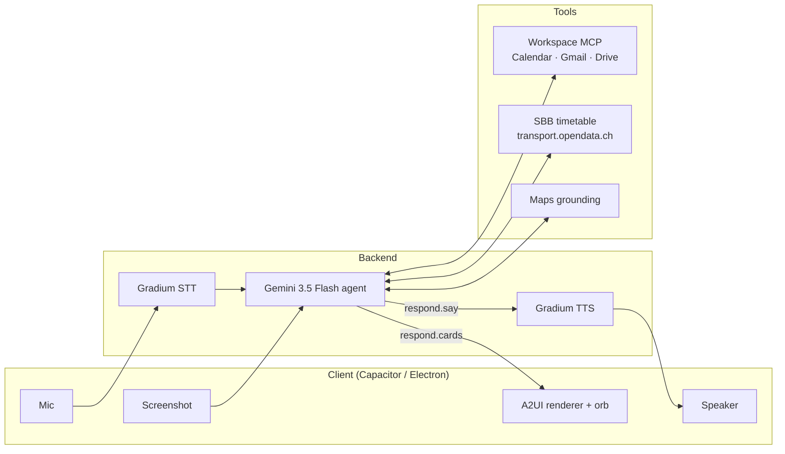

# Voice agent with generative UI: architecture and build plan

Oct 10, 2026 · @g

## Concept and demo story

A voice agent with a Swiss mascot (a beaver, for now) that answers with generated UI cards instead of chatbot pop-ups. It sees what is on screen, reads Google Calendar and Gmail, checks SBB trains, and speaks one short line while the cards appear.

Design rule: say less, show more. The voice gives the gist; the cards carry times, platforms and flight numbers.

**The 20-second demo**

1. On screen: a friend's message, "Dinner in Bern Thursday at 7?"
2. User: "Can I make it?"
3. The agent reads the screen, finds the planted 17:30 call in the calendar, and looks up SBB trains after it.
4. The mascot says one sentence ("Your call ends at six, and there's a train right after that gets you in just before seven") while a conflict card and a train card appear.
5. Full-circle moment: the hackathon itself shows up in the calendar through its Luma invite.

That one flow shows screen vision, MCP, live transit data, voice and generated UI.

## Architecture overview

The client only captures voice and screenshots and renders cards; the agent and every tool run on our backend.

Voice and screenshots flow into the agent; its `respond` call splits into a spoken line for Gradium TTS and cards for the A2UI renderer.

| Layer | Component | Role |
| --- | --- | --- |
| Client | React app in Capacitor (iPhone, Android) or Electron (Mac) | Mic, speaker, screenshot, orb, A2UI renderer |
| Voice | Gradium STT and TTS | Speech in; one short spoken line out |
| Agent | Gemini 3.5 Flash via the Gemini SDK | Reasons, calls tools, ends each turn with `respond(say, cards)` |
| Tools | Workspace MCP, SBB timetable, Maps grounding | Calendar, mail and flights, trains, places |
| UI | A2UI cards and thinking-orbs | Conflict, train, flight and event cards |

## Voice layer: Gradium

Gradium handles speech-to-text and text-to-speech, so Gemini only ever sees and returns text.

- **Languages:** English, French, German, Spanish and Portuguese, with mid-sentence switching. No Italian. ([docs](https://docs.gradium.ai/guides/introduction))
- **Latency:** streaming time-to-first-token under 300 ms.
- **Mascot voice:** clone a voice from a sample of about 10 seconds.
- **Sync with the UI:** word-level timestamps let a card light up when the mascot names it. ([gradium.ai](https://gradium.ai))
- **Turn-taking:** semantic voice activity detection estimates when the speaker has actually finished.

Trade-off: Gemini's [Live API](https://cloud.google.com/vertex-ai/generative-ai/docs/live-api) takes voice and screen frames (1 frame per second) natively, but it does its own audio and would replace Gradium. With Gradium, attach a screenshot to the turn instead of streaming the screen.

## Agent: Gemini 3.5 Flash with MCP

Use the plain Gemini SDK with MCP tools on our own backend; skip ACP.

- **Model:** Gemini 3.5 Flash. Fast, with function calling, built-in Search and Maps grounding, and built-in computer use if we need it later. ([Google](https://blog.google/innovation-and-ai/models-and-research/gemini-models/introducing-computer-use-gemini-3-5-flash)) *Update 10 Oct: `gemini-3.5-flash` was deprecated on 8 Oct; the MVP uses `gemini-3.8-flash`, see [contracts](contracts.md#tools).*
- **MCP:** the Python and JavaScript SDKs take an MCP session as a tool and run the tool loop automatically (`mcpToTool(client)` in JS). It is experimental and uses MCP tools only, not resources or prompts. ([FastMCP](https://gofastmcp.com/integrations/gemini), [js-genai](https://github.com/googleapis/js-genai))
- **Turn contract:** every turn ends with a `respond(say, cards)` tool call. `say` goes to Gradium TTS, `cards` to the A2UI renderer, so we never parse free text.
- **Why not ACP:** the [Agent Client Protocol](https://www.morphllm.com/agent-client-protocol) connects code editors to coding agents such as Gemini CLI or Claude Code. Our client is a voice and cards app, and A2UI already covers agent-to-UI.
- **ADK as the alternative:** its `McpToolset` manages MCP connections and can filter to read-only tools. A2UI ships ADK samples. The cost is more framework, plus a bridge between ADK's REST/SSE and A2UI's A2A transport. ([ADK](https://adk.dev/tools-custom/mcp-tools/))

**Latency tactics**

- Preload today's calendar and the planted flight email into the prompt at session start, so many turns need no tool call.
- While tools run, set the orb to "searching" and have the mascot say a short filler line ("Checking your calendar…").
- Let independent lookups, such as calendar and SBB, run in the same step instead of one after the other.

## Tools and data

APIs are the source of truth; screen vision only adds context about what the user is looking at.

| Source | Access | Notes |
| --- | --- | --- |
| Gmail, Calendar, Drive | [Google Workspace remote MCP servers](https://developers.google.com/workspace/guides/configure-mcp-servers), one per product, OAuth 2.0 | Developer Preview: the Cloud project must be enrolled or the MCP services never appear; enrollment takes a couple of days, so the MVP uses REST. Calendar MCP scopes are read-only. Fallback: REST APIs as Gemini function tools. |
| SBB trains | [transport.opendata.ch](https://www.transport.opendata.ch/docs.html) | No API key, CORS enabled. Connections with platforms and transfers; departure boards with live delays. |
| Flights | Gmail: a planted confirmation email | No Google Flights API. Amadeus closed its free self-service portal on 17 July 2026; Duffel is self-serve if real search is needed. ([Geekflare](https://geekflare.com/guides/flight-booking-api/)) |
| Places and maps | Gemini Maps grounding | Built into the model, no extra integration. |
| Events | Luma | The [API](https://help.luma.com/p/luma-api) needs Luma Plus and a key per calendar. Use the Luma invite already in Google Calendar instead. |

**Planted demo data in the temporary Workspace account**

- [ ] Calendar event that clashes with the dinner (created by hand or via REST, since the Calendar MCP can't write)
- [ ] Flight confirmation email in Gmail
- [ ] Luma invite for the hackathon in Google Calendar
- [ ] OAuth done once on a laptop, refresh token stored on the backend

## Generative UI: A2UI cards and orbs

The model never writes UI code. It returns JSON that picks components from our catalog, and the client renders them natively.

- **Protocol:** [A2UI](https://a2ui.org/reference/renderers/) v0.9.1, with v1.0 as a candidate, Apache 2.0. The agent can only request components that exist in the client's trusted catalog.
- **Renderers:** official React, Flutter, Angular and Lit; an official Jetpack Compose renderer in alpha; SwiftUI still planned, with the community a2ui-swift renderer available.
- **Catalog, first pass:** Orb, ConflictCard (move / skip / keep), TrainCard, FlightCard, EventCard, MascotBubble.
- **Orbs:** [thinking-orbs](https://libraries.dev/orbs) has nine animated states, installs from npm for React, and has a SwiftUI version. The React Native port is not on npm yet. Map its states to listening, thinking, searching and speaking.

## Screen vision by platform

The Mac sees the screen continuously, the iPhone gets a one-press screenshot, and mobile browsers can't capture other apps at all.

| Platform | Method | Effort |
| --- | --- | --- |
| Mac (Electron) | Screen capture after granting Screen Recording permission; continuous | Low |
| Android (native) | Screen capture after a one-time consent prompt | Medium |
| iPhone | Action Button or Back Tap Shortcut: Take Screenshot, POST the image to our backend, Open App ([Apple](https://support.apple.com/en-lk/guide/shortcuts/apd350ce757a/ios)) | Low, no Swift |
| iPhone | Share sheet from a screenshot | Low, slower to use |
| iPhone | [Visual Intelligence](https://developer.apple.com/documentation/visualintelligence/integrating-your-app-with-visual-intelligence) (iOS 26) via App Intents; built for search results | Medium |
| iPhone | [ReplayKit broadcast extension](https://www.forasoft.com/blog/article/how-to-implement-screen-sharing-in-ios-1193), 50 MB memory limit; continuous | High |
| Mobile web or PWA | Not possible for other apps | — |

Send frames on demand, not as a stream. Treat screen content as untrusted, because an on-screen message can carry instructions aimed at the agent. The agent stays read-only and confirms before sending or booking anything.

## Clients and platforms

One React app in two wrappers: Capacitor for iPhone and Android, Electron for the Mac.

- Electron is desktop-only and can't target the iPhone. It is the Mac wrapper because it can capture the screen there.
- Flutter with the [GenUI SDK](https://flutter.dev/blog/rich-and-dynamic-user-interfaces-with-flutter-and-generative-ui) is the alternative if someone already knows Flutter: iOS, Android and macOS from one codebase.
- Home-screen widgets can't stream generated UI. [iOS widgets](https://developer.apple.com/documentation/widgetkit/adding-interactivity-to-widgets-and-live-activities) are timeline snapshots with buttons and toggles that fire App Intents; Android Glance is limited to what RemoteViews supports. Optional: a simple widget that shows the latest card and opens the app.

**iPhone build: about half a day on top of a working web app, Mac with Xcode required**

| Step | Time | Risk |
| --- | --- | --- |
| Add Capacitor, open in Xcode, run on the iPhone | 1–2 h (first time) | Low |
| Microphone, audio playback, echo | 1–3 h | Medium |
| Screenshot Shortcut on the Action Button | ~1 h | Low |
| Orbs, A2UI cards, WebSocket to backend | ~0 | Low |

**Gotchas**

- Google blocks OAuth in embedded web views, so OAuth runs on the backend only and the phone never signs in to Google.
- With the mic on, iOS can route playback to the quiet earpiece. Fix: a few lines of Swift setting the audio session to play-and-record with default-to-speaker.
- The mascot's voice can leak into the mic. Turn on echo cancellation; use push-to-talk on the orb in a noisy hall.
- iOS plays no audio before a first tap, so the session starts with a tap on the orb.
- JavaScript pauses in the background and the WebSocket drops, so the demo app stays in front.
- A free Apple ID installs the app on your own iPhone for 7 days, with Developer Mode on. Set it up the day before.
- Live reload from the laptop: `npx cap run ios --livereload`.
- Fallback: the web app in Safari plus the same Shortcut covers the whole demo without Capacitor.

## Optional showpieces: computer use and eye tracking

Both are risky on stage. Use at most one, with a fallback ready.

**Computer use**

- **Android:** Gemini already completes tasks in select food, grocery and rideshare apps, running them in a background virtual window ([Neowin](https://www.neowin.net/news/googles-new-gemini-agent-on-android-can-now-use-3rd-party-apps-to-run-errands-for-you/)). For our own agent: [DroidRun / Mobilerun](https://github.com/ClawMobile/droidrun) or mobile-use over USB debugging, or an MCP server running on the phone through accessibility services.
- **Mac:** the Claude and ChatGPT desktop apps already drive real apps. For our agent: Gemini 3.5 Flash computer use (78.4% on OSWorld-Verified, self-reported) or Claude's computer-use tool; [Cua](https://github.com/JanSystemic/cua) runs disposable macOS VMs as a sandbox.
- **iPhone:** no third-party control. Through a Mac, iPhone Mirroring plus [mirroir-mcp](https://ai.g2.com/marketplace/tools/iphone-mirroir-mcp) or phone-harness lets an agent tap and type on a real iPhone. Mirroring is not available in the EU; [WebDriverAgent](https://jeangalea.com/control-automate-iphone-webdriveragent/) over USB is the workaround. iOS 27 Siri App Actions only reach apps that opted in.
- **Rules for the demo:** each step is a screenshot, a model call and an action, so it is slow; it breaks on pop-ups and logins; stop before payment; use a demo phone only.

**Eye tracking**

- iOS built-in Eye Tracking with Dwell Control works in any app but gives the app no gaze data.
- ARKit `lookAtPoint` on Face ID iPhones is jittery; good enough for 2–4 large targets with smoothing and a dwell timer, not for buttons in a card. ([Apple forums](https://developer.apple.com/forums/thread/803872))
- Android and web: MediaPipe iris landmarks or WebGazer, with calibration and coarser accuracy. Widgets have no camera access.
- Where it fits: looking at an orb grows it, a dwell of about a second confirms, and tap stays as the backup.

## Risks and day-one checklist

The day-one checks decide which fallbacks we need, so run them before writing app code.

- [ ] Cloud project enrolled in the Workspace Developer Preview (otherwise REST tools)
- [ ] OAuth on the temporary account works from the backend; refresh token stored
- [ ] Gradium key set up; mascot voice chosen or cloned; German and French tested
- [ ] transport.opendata.ch returns the demo connection
- [ ] Calendar conflict, flight email and Luma invite planted
- [ ] Demo devices decided: Mac for continuous screen vision, iPhone for the one-press screenshot
- [ ] App installed and signed on the demo iPhone the day before
- [ ] iPhone Mirroring confirmed on our Mac and iPhone, if computer use is in the demo
- [ ] Backup video of the full demo recorded

| Risk | Fallback |
| --- | --- |
| Workspace MCP preview not enabled | Gmail and Calendar REST APIs as Gemini function tools |
| Audio routing or echo on the iPhone | Push-to-talk; run the voice demo on the Mac |
| Slow multi-tool turns | Preloaded context, filler line, parallel lookups |
| Hall noise or weak Wi-Fi | Push-to-talk, phone hotspot, backup video |
| Computer use breaks on stage | Sped-up recording; stop before payment |

## Sources

- [Gradium API docs](https://docs.gradium.ai/guides/introduction) · [Gradium](https://gradium.ai)
- [Google: computer use in Gemini 3.5 Flash](https://blog.google/innovation-and-ai/models-and-research/gemini-models/introducing-computer-use-gemini-3-5-flash)
- [Google Cloud: Live API](https://cloud.google.com/vertex-ai/generative-ai/docs/live-api)
- [Google: configure the Workspace MCP servers](https://developers.google.com/workspace/guides/configure-mcp-servers) · [Zeta Alpha: Workspace MCP scopes and preview](https://docs.zeta-alpha.com/gen-ai/customize/guides/configuring-capabilities/connecting-mcp-servers/how-to-connect-google-workspace)
- [FastMCP: Gemini SDK integration](https://gofastmcp.com/integrations/gemini) · [Google Gen AI JS SDK](https://github.com/googleapis/js-genai) · [ADK: MCP tools](https://adk.dev/tools-custom/mcp-tools/)
- [Morph: Agent Client Protocol](https://www.morphllm.com/agent-client-protocol)
- [A2UI renderers](https://a2ui.org/reference/renderers/) · [A2UI roadmap](https://a2ui.org/roadmap/) · [Android: A2UI for Compose](https://developer.android.com/develop/ui/compose/agentic) · [Flutter GenUI SDK](https://flutter.dev/blog/rich-and-dynamic-user-interfaces-with-flutter-and-generative-ui)
- [libraries.dev: thinking orbs](https://libraries.dev/orbs)
- [transport.opendata.ch docs](https://www.transport.opendata.ch/docs.html) · [Luma API](https://help.luma.com/p/luma-api) · [Geekflare: flight APIs 2026](https://geekflare.com/guides/flight-booking-api/)
- [Apple: interactive widgets](https://developer.apple.com/documentation/widgetkit/adding-interactivity-to-widgets-and-live-activities) · [Apple: onscreen items in Shortcuts](https://support.apple.com/en-lk/guide/shortcuts/apd350ce757a/ios) · [Apple: Visual Intelligence](https://developer.apple.com/documentation/visualintelligence/integrating-your-app-with-visual-intelligence) · [Fora Soft: ReplayKit](https://www.forasoft.com/blog/article/how-to-implement-screen-sharing-in-ios-1193)
- [Neowin: Gemini agent on Android](https://www.neowin.net/news/googles-new-gemini-agent-on-android-can-now-use-3rd-party-apps-to-run-errands-for-you/) · [DroidRun](https://github.com/ClawMobile/droidrun) · [Cua](https://github.com/JanSystemic/cua) · [mirroir-mcp](https://ai.g2.com/marketplace/tools/iphone-mirroir-mcp) · [Jean Galea: WebDriverAgent](https://jeangalea.com/control-automate-iphone-webdriveragent/)
- [Apple forums: ARKit eye tracking](https://developer.apple.com/forums/thread/803872)
